# Star animations

I needed a bunch of animations for a project - So to save you AI tokens I thought I would share them here.

Built with three.js.

## How they work

- **Engine:** `mountStars(panel, options)` in `staranimations.html`. It uses three.js r187 (from jsdelivr) and `GPUComputationRenderer`: each particle springs towards its target, with curl-noise swirl only while travelling, so shapes assemble with sparkles and then sit still. Points are additive and soft, with bloom.
- **Shapes:** each is a function returning target points `[x, y, z, code + brightness + accent]` in local units.
- **Motion:** optional `view` (a fixed tilt), `groups` (up to 8 parts turning on their own centres and axes) and a `motion` GLSL hook that moves or brightens particles at draw time.
- **No interaction:** nothing responds to the pointer or scroll.
- **Performance:** tiles mount lazily and at most 5 WebGL contexts are alive at once. Tiles pause off screen.
- **Fallbacks:** with reduced motion, shapes appear already formed and still. Without WebGL, each tile shows a static text version.

## Using one

1. Copy the star engine and the shape helpers from `staranimations.html`.
2. Copy the piece's shape function (and any constant just above it).
3. Mount it with that piece's `SCENES` entry plus a `place()` for your panel:

```js
mountStars(panel, { ...SCENES.galaxy, size: 176, accent: '#4a63ff',
  place: (W, H, mob, sh) => ({ ppu: 150, cx: W * .68, cy: H / 2 }) });
```

`window.__stars(n)` fast-forwards the simulation n steps (handy for screenshots).

## The pieces

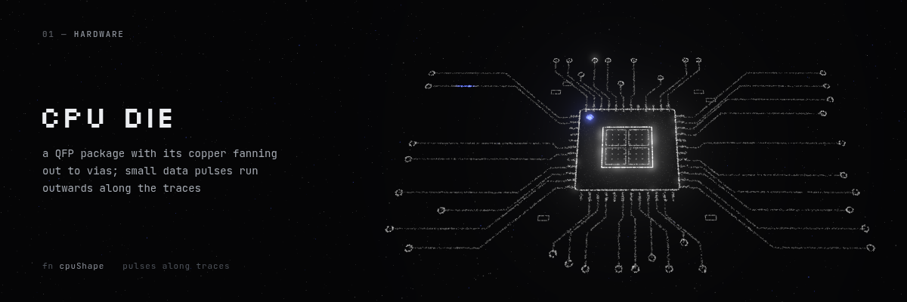

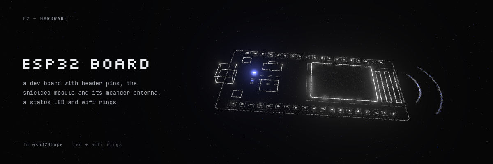

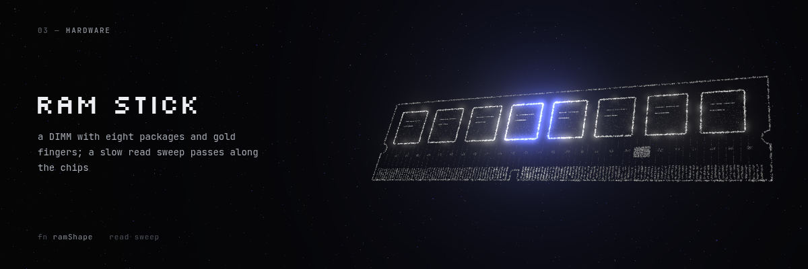

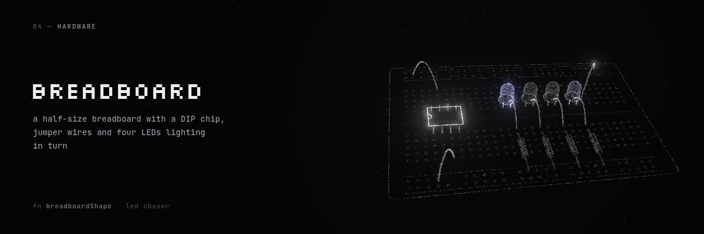

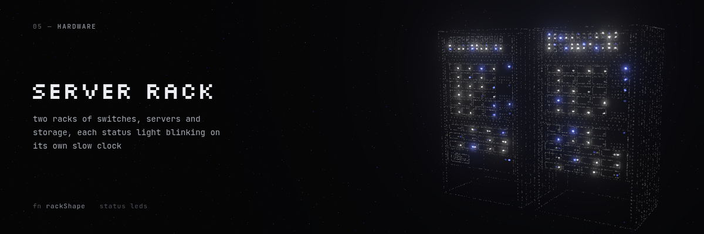

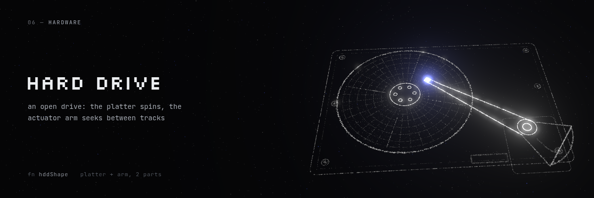

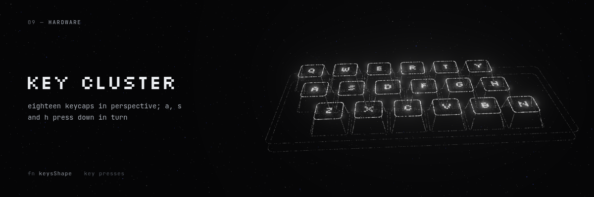

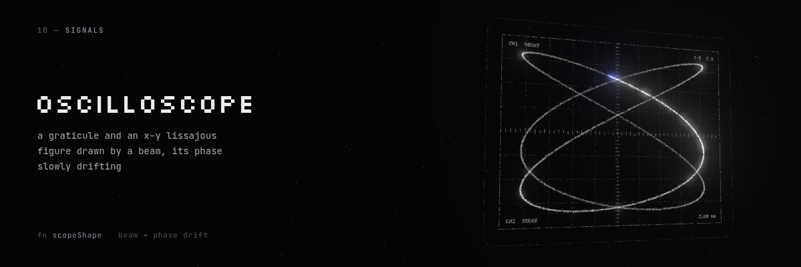

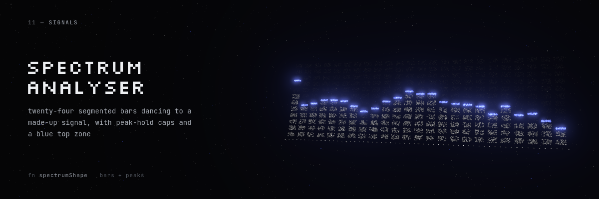

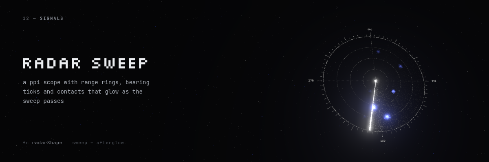

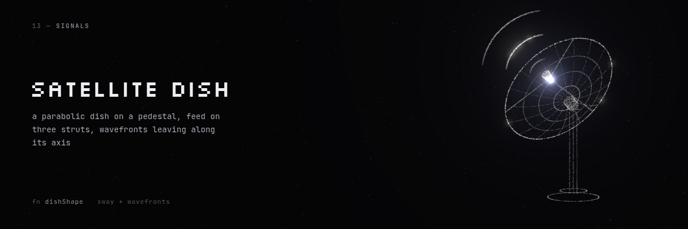

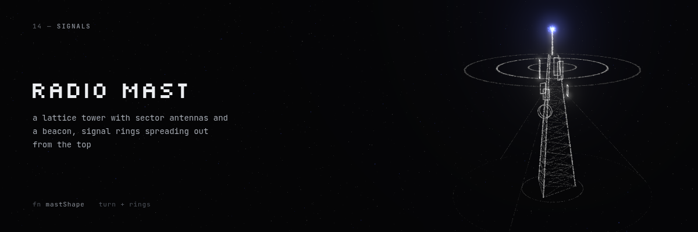

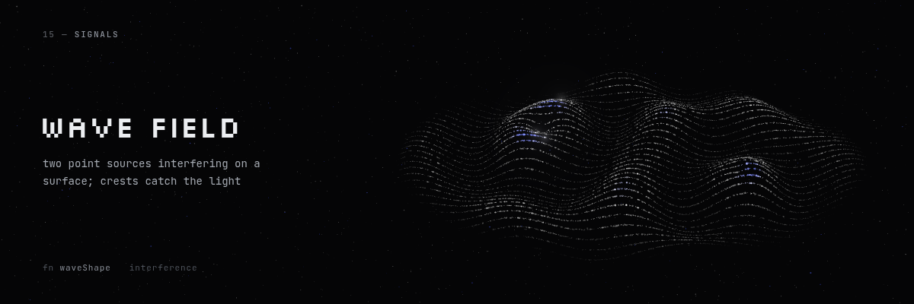

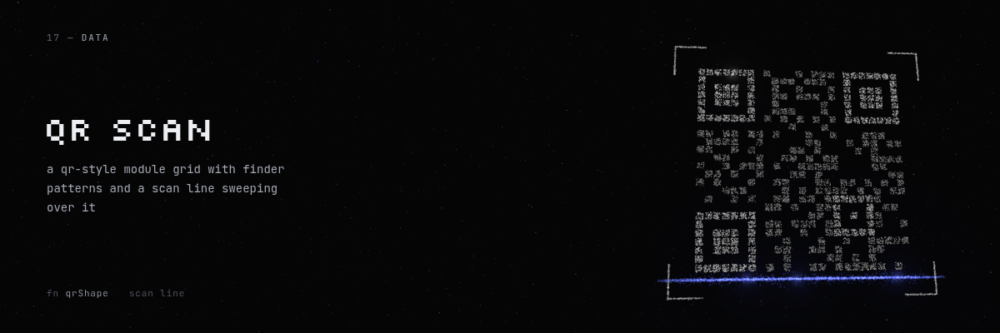

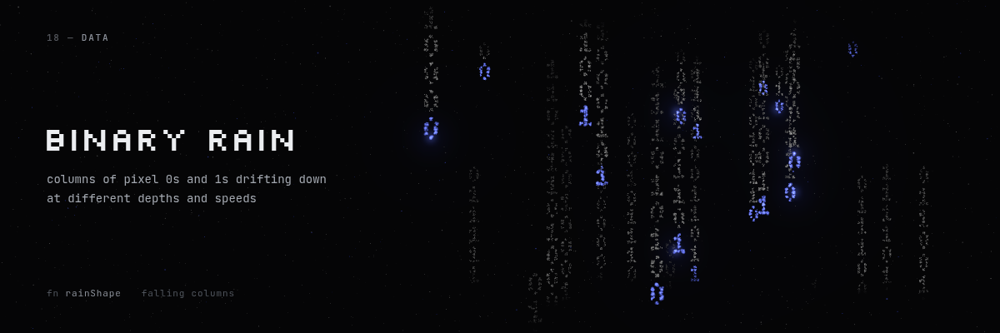

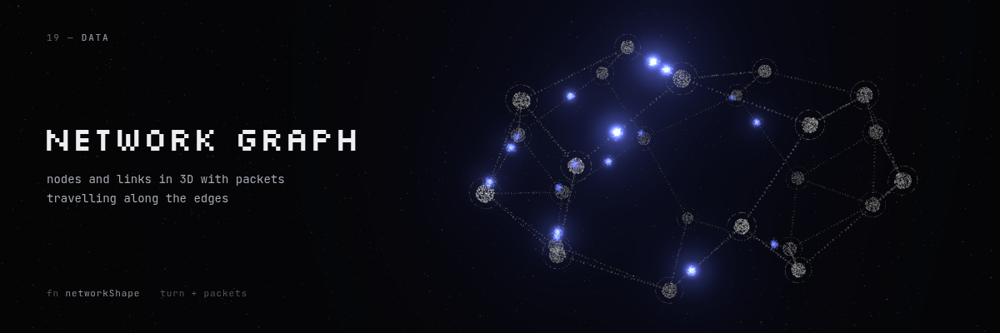

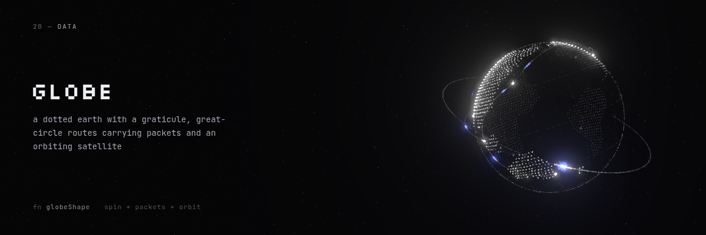

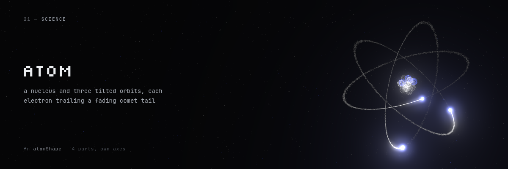

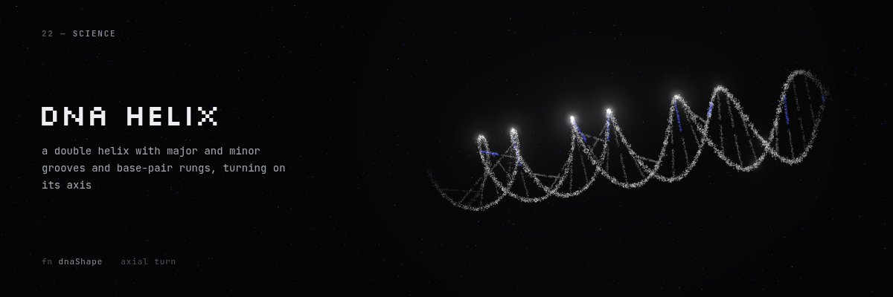

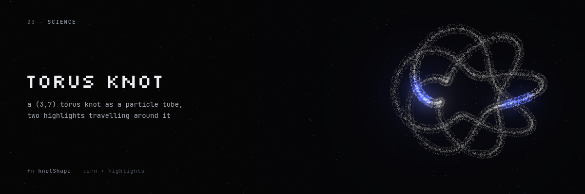

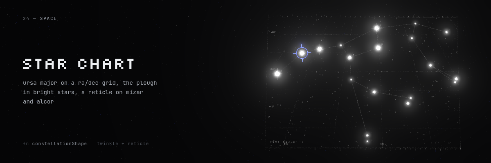

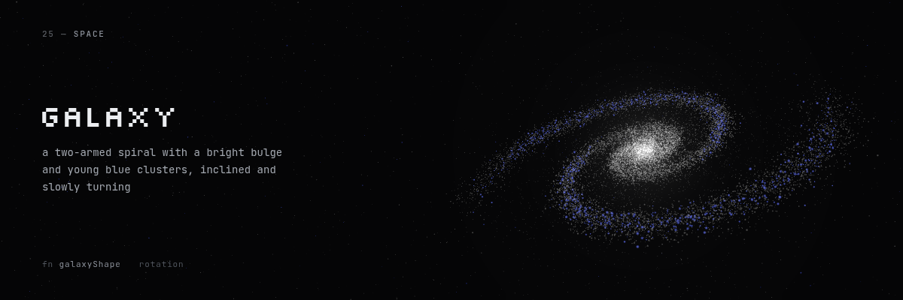

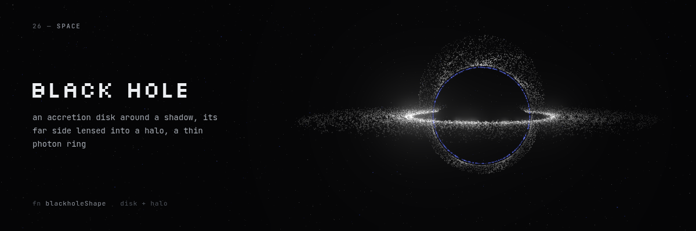

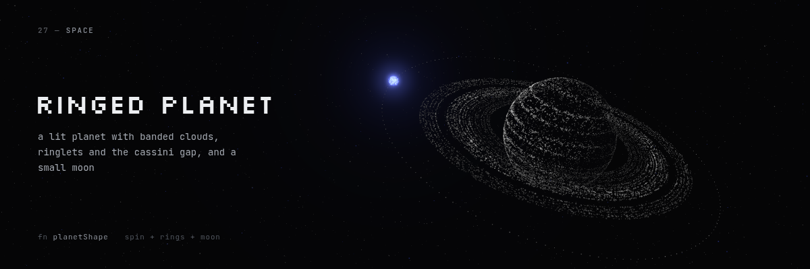

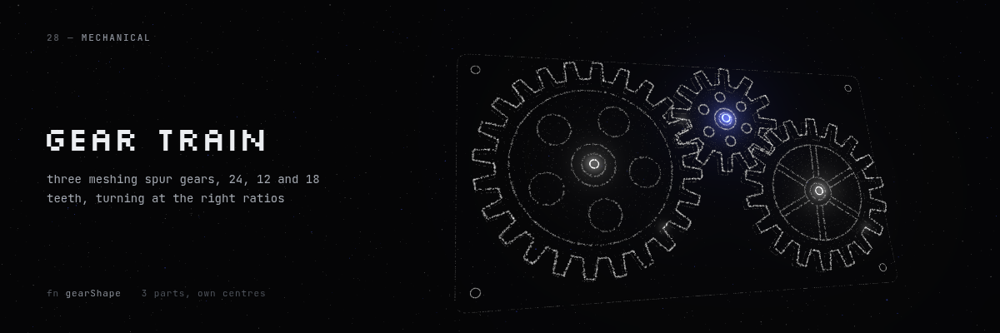

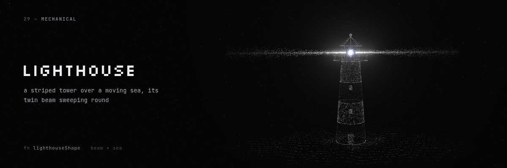

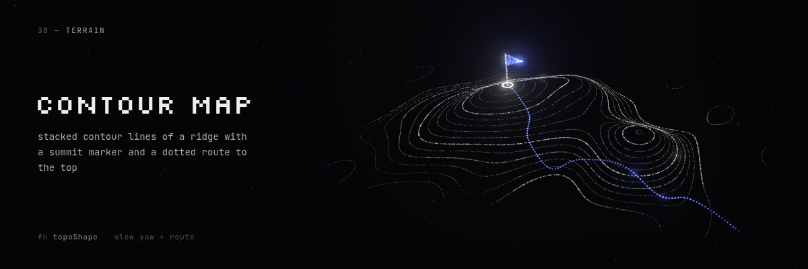

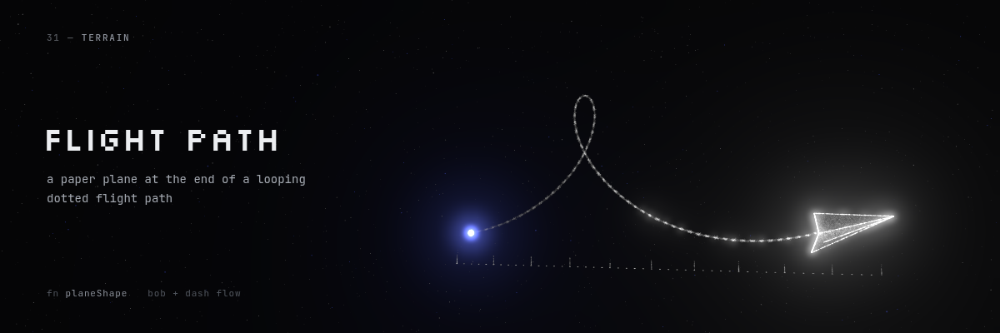
